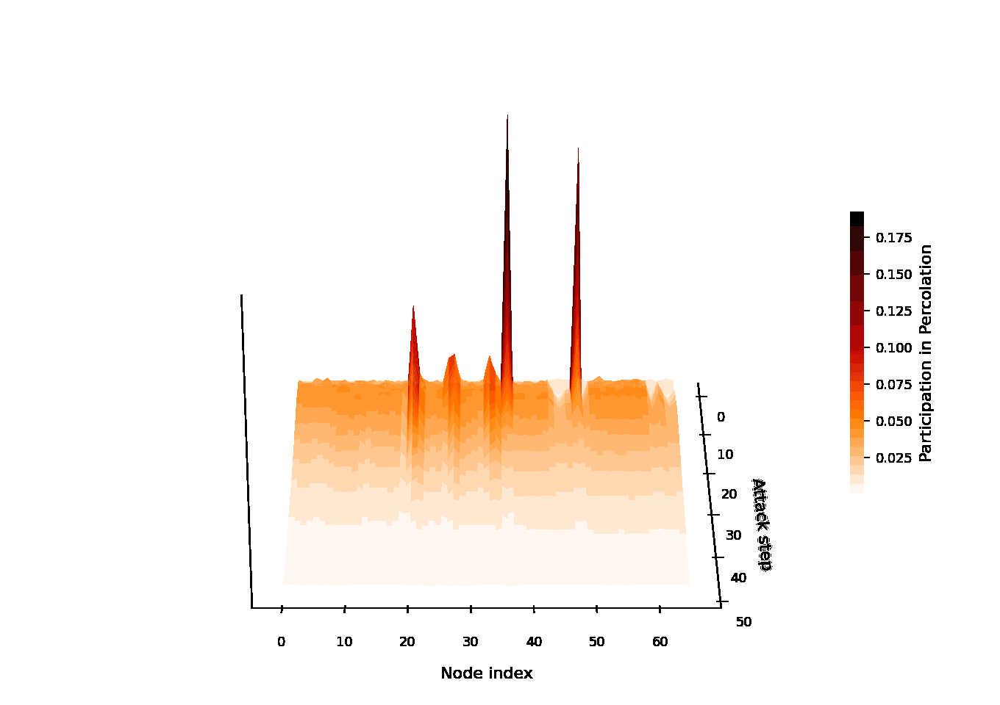
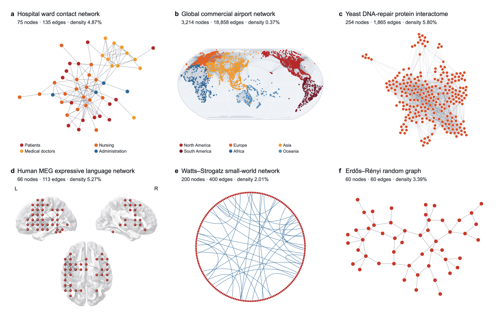

# NetPiP: Participation in Percolation

<p align="center">
  
  <br>
  <em>Group-average PiP surface of the expressive language network.</em>
</p>

**Participation in Percolation (PiP): a probabilistic metric for identifying critical nodes in complex networks**

Minarose M. Ismail¹,², Brady J. Williamson³, Hansel M. Greiner⁴, Darren S. Kadis¹,²

¹ Department of Physiology, University of Toronto  
² Neurosciences and Mental Health, Hospital for Sick Children, Toronto  
³ University of Cincinnati College of Medicine, Department of Radiology  
⁴ Department of Pediatrics, College of Medicine, University of Cincinnati

PiP is a probabilistic metric of how much each node's removal drives a network
to break apart. It samples many uniformly
random node-removal orders ("attacks"), finds the step at which each attack
reaches its **percolation point** (the first maximum of the second-largest
connected component, when a substantial piece first splits off), and estimates
how often each node has been removed by then. Sampling replaces the impossible
enumeration of all N! orders: estimates stabilise after a vanishingly small
fraction of them.

## Networks tested

<p align="center">
  
  <br>
  <em>The six networks analysed in the paper: (a) hospital ward contacts, (b) global airports,
  (c) yeast DNA-repair protein interactions, (d) human MEG expressive language network,
  (e) Watts–Strogatz small world, (f) Erdős–Rényi random graph. Data and sources are in
  <a href="data"><code>data/</code></a>.</em>
</p>

This repository contains:

| Folder | What it is |
|---|---|
| [`src/netpip`](src/netpip) | Python toolbox (reference implementation; Numba-compiled sampler) |
| [`matlab/+netpip`](matlab) | MATLAB toolbox with the same functions |
| [`examples`](examples) | Run PiP on your own network: quick start and a full analysis script |
| [`reproduce`](reproduce) | One command per paper figure and a check of every key number |
| [`data`](data) | The six networks of the paper, their sources and licences, and a script that rebuilds them |
| [`results/paper_1B`](results/paper_1B) | Saved 1-billion-attack PiP counts, checkpoints and attack orders |
| [`tests`](tests) | Unit tests, including an exact replay of the paper's sampling |
| [`figures`](figures) | Images shown on this page, and the final paper figures in [`figures/paper`](figures/paper) |

## Installation

```bash
git clone https://github.com/Minarose/NetPiP.git
cd NetPiP
pip install -e ".[paper]"        # toolbox + what the reproduction scripts need
```

The toolbox alone needs NumPy, SciPy and Numba (`pip install -e .`). Python ≥ 3.9.
A conda environment with the exact versions used for the paper is in
[`environment.yml`](environment.yml).

## Quick start

```python
import netpip

A = netpip.load_adjacency("my_network.npy")          # binary, symmetric, zero diagonal
result = netpip.run_pip(A, n_attacks=1_000_000, seed=1, checkpoints=[10_000, 100_000])
scores = result.scores()                              # linear-weighted PiP score per node
print(result.ranking()[:10])                          # 10 most critical nodes (0-based)
print(result.rms_convergence())                       # has sampling converged? (paper: RMS <= 0.005)
```

Edge lists, `.csv`, `.mat` and weighted matrices are supported; see
[`examples/README.md`](examples/README.md). A complete analysis with tables and
figures for your own network is one command:

```bash
python examples/analyze_network.py my_network.csv --attacks 1e7 --seed 1
```

### How many attacks?

Sample until the RMS change in the PiP surface between checkpoints falls below
0.005 (`result.rms_convergence()`). In the paper this took 10–500 million
attacks for networks of 60–3,214 nodes. The sampler handles about a million
attacks per second for a 66-node network on a laptop (more with more cores);
time grows roughly with the number of nodes and edges.

## Reproducing the paper

Everything is computed from the saved 1-billion-attack counts in
`results/paper_1B/`, so it takes seconds rather than days:

```bash
python reproduce/run_all.py          # all numbers and figures -> reproduce/output/  (under a minute)
```

| Script | Reproduces |
|---|---|
| `reproduce/key_numbers.py` | Peak nodes, RMS checkpoints, removals to the percolation point (3, 91, 45, 2, 4, 1), the 51.1–87.1% reduction, Supplementary Table 1 values and the language critical cluster. **Exits with an error if anything differs from the paper.** |
| `reproduce/fig3_surfaces.py` | Fig. 3, PiP surfaces |
| `reproduce/fig4_attacks.py` | Fig. 4, PiP- vs centrality-ordered attacks |
| `reproduce/fig5_language_map.py` | Fig. 5, critical nodes of the brain language network |
| `reproduce/supp_fig1_adjacency.py` | Supplementary Fig. 1, adjacency matrices |
| `reproduce/supp_fig2_rms.py` | Supplementary Fig. 2, RMS convergence |
| `reproduce/supp_fig3_lcc.py` | Supplementary Fig. 3 and Table 1, LCC/SLCC trajectories |
| `reproduce/resample.py` | Reruns the sampling with the paper's seeds and checks it against the saved checkpoints |

The final figures as published with the paper (Figs 1–5 and Supplementary
Figs 1–3) are saved as PNGs in [`figures/paper`](figures/paper).

Figures 1 and 2 are schematic and network drawings assembled for the paper
(Fig. 2 panels were drawn with NetworkX/matplotlib as described in Methods) and
are not regenerated here.

**Rerunning the sampling.** Random orders come from `numpy.random.default_rng(seed)`
with the seeds listed in Methods, and the stream does not depend on batch size,
so a rerun reproduces the paper's counts exactly:

```bash
python reproduce/resample.py                          # 1M attacks per network, compared with saved checkpoints (~1 min)
python reproduce/resample.py --network language --attacks 25e6
python reproduce/resample.py --full                   # 1 billion attacks per network (hours; airport about a day)
```

## The method in brief

For each sampled order, nodes are removed one at a time and the sizes of the
largest (LCC) and second-largest (SLCC) connected components are tracked
exactly (union–find, adding nodes back in reverse order). The percolation point
k\* is the earliest step at which the SLCC reaches its maximum; every node
removed up to and including k\* participates. Grouping attacks by k\* gives
`counts[k]` and `hits[k, i]`, and the PiP surface P[k, i] = hits / counts. Steps
are weighted to emphasise early fragmentation (linear for scores, rankings and
clustering; exponential for visualisation), and a node's PiP score is the mean
of its weighted profile. See the paper's Methods for details.

## MATLAB

```matlab
addpath('matlab');
result = netpip.run_pip(A, 1e6, 'Seed', 1, 'Checkpoints', [1e4 1e5]);
scores = netpip.pip_scores(result.counts, result.hits, 'linear');
```

The MATLAB toolbox implements the same definitions. MATLAB's random number
generator differs from NumPy's, so MATLAB runs are statistically equivalent
but not bit-identical to the paper's Python runs. See [`matlab/README.md`](matlab/README.md).

## Citation

If you use PiP, please cite the article (see [`CITATION.cff`](CITATION.cff)):

> Ismail, M. M., Williamson, B. J., Greiner, H. M. & Kadis, D. S. Participation in
> Percolation (PiP): a probabilistic metric for identifying critical nodes in
> complex networks. (2026).

## Earlier version

The original PiP release (language network only, Wilson-interval stopping rule)
is on the `main` branch history; see [`CHANGELOG.md`](CHANGELOG.md).

## Licence

Code: MIT ([`LICENSE`](LICENSE)). Data: see [`data/README.md`](data/README.md)
for the source and licence of each network.
